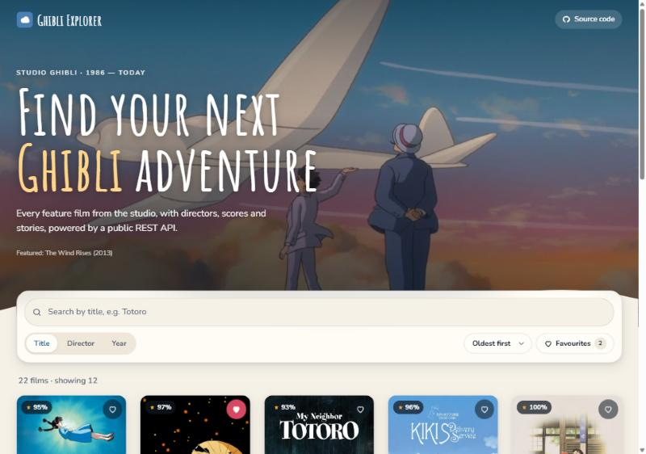
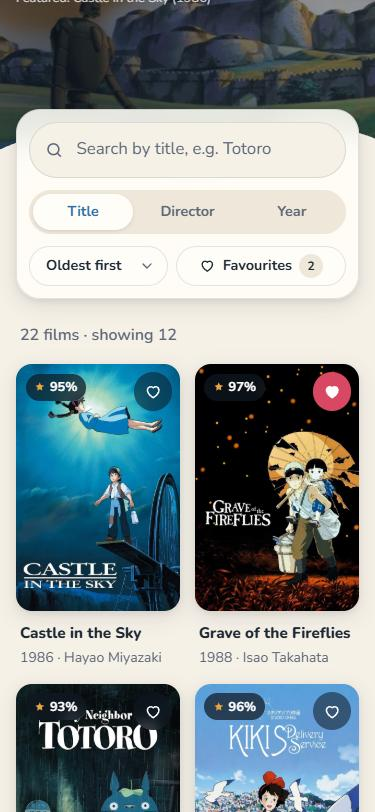
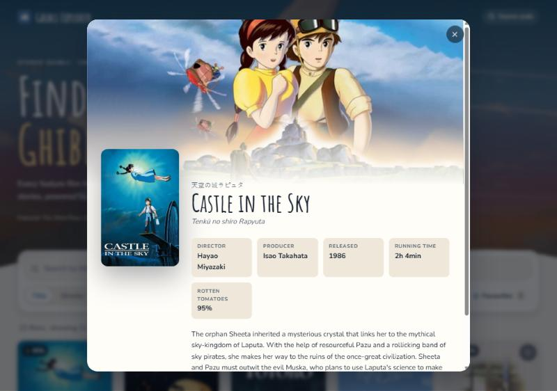

# Ghibli Explorer

[](https://github.com/binnahv/Studio-Ghibli/actions/workflows/ci.yml)


Catálogo responsivo dos longas-metragens do Studio Ghibli: busca por título, diretor ou década, ordenação, lista de favoritos e página de detalhes de cada filme. Feito com **HTML, CSS e JavaScript puro**, sem framework nem bundler, consumindo a [Studio Ghibli API](https://ghibliapi.vercel.app).

**[Ver o site no ar](https://binnahv.github.io/Studio-Ghibli/)**

<p align="center">
  
  
</p>

## Funcionalidades

- **Busca instantânea** (com debounce) por título, título japonês romanizado, diretor ou ano. Ignora acentos e maiúsculas, e `199` encontra a década de 1990 inteira.
- **Ordenação** por ano, nota no Rotten Tomatoes ou ordem alfabética.
- **Favoritos** salvos no `localStorage`, com filtro "só favoritos".
- **Estado na URL**: toda busca vira um link compartilhável (`?q=miya&in=director&sort=score-desc`).
- **Modal de detalhes** com banner, pôster, título original, produtor, duração e sinopse. No celular ele abre como *bottom sheet*.
- **Estados de interface**: skeleton enquanto carrega, mensagem de lista vazia e erro com botão "Try again".
- **PWA**: instalável e funciona offline depois da primeira visita (service worker com cache *network-first* para o app e *cache-first* para imagens).
- **Tema claro e escuro** automático (`prefers-color-scheme`).

<p align="center">
  
</p>

## Decisões técnicas

| Decisão | Por quê |
| --- | --- |
| JavaScript puro com ES Modules | Mostra os fundamentos (DOM, eventos, `fetch`, módulos) sem esconder nada atrás de um framework. |
| Lógica separada da interface | `filters.js`, `favorites.js` e `format.js` são funções puras, sem DOM. Por isso têm testes automatizados. |
| Nada de `innerHTML` com dados da API | Todo texto entra via `textContent`, o que elimina risco de XSS. |
| `<dialog>` nativo no lugar do modal do Bootstrap | Foco preso, tecla Esc e retorno de foco já vêm do navegador. Tirar o Bootstrap reduziu o peso da página. |
| *Event delegation* nos cards | Um único listener na grade em vez de dois por card. |
| CSS com *design tokens* | Cores, raios e sombras em variáveis; o tema escuro só troca os valores. |

### Acessibilidade

HTML semântico (`header`, `main`, `nav`, `fieldset`, `dl`), link "pular para o conteúdo", foco visível em todos os controles, botões com `aria-label` e `aria-pressed`, região `aria-live` anunciando o número de resultados e respeito a `prefers-reduced-motion`. Atalho: <kbd>/</kbd> foca a busca.

## Estrutura

```
├── index.html            # Marcação e ícones SVG reutilizáveis
├── css/style.css         # Tokens, layout responsivo, componentes e animações
├── js/
│   ├── app.js            # Ponto de entrada: estado, eventos e sincronização com a URL
│   ├── api.js            # Acesso à API (timeout, validação da resposta)
│   ├── filters.js        # Busca, ordenação e paginação (puro)
│   ├── favorites.js      # Persistência dos favoritos (puro)
│   ├── format.js         # Textos exibidos na tela (puro)
│   ├── render.js         # Criação dos elementos no DOM
│   ├── modal.js          # Modal de detalhes
│   └── config.js         # Constantes
├── tests/                # Testes com o runner nativo do Node (node:test)
├── service-worker.js     # Cache offline
└── .github/workflows/    # CI: roda os testes e publica no GitHub Pages
```

## Como rodar

O projeto é estático, mas usa ES Modules, então precisa de um servidor local (abrir o `index.html` direto pelo explorador de arquivos não funciona).

```bash
git clone https://github.com/binnahv/Studio-Ghibli.git
cd Studio-Ghibli

npm start                      # com Node 20+
# ou
python -m http.server 5173     # com Python
```

Depois acesse <http://localhost:5173>. A extensão Live Server do VS Code também funciona.

### Testes

```bash
npm test
```

Usa o `node:test`, nativo do Node 20+, sem nenhuma dependência para instalar. Os testes também rodam a cada push pelo GitHub Actions.

## Próximos passos

- [ ] Página de personagens e locais usando os outros endpoints da API
- [ ] Testes end-to-end com Playwright
- [ ] Versão em português da interface (i18n)

## Créditos

- Dados: [Studio Ghibli API](https://ghibliapi.vercel.app) (projeto open source da comunidade)
- Pôsteres e banners: servidos pela API a partir do [TMDB](https://www.themoviedb.org)
- Fontes: [Amatic SC](https://fonts.google.com/specimen/Amatic+SC) e [Nunito](https://fonts.google.com/specimen/Nunito), via Google Fonts

Projeto de fã, feito para estudo e sem fins lucrativos. Não tem vínculo com o Studio Ghibli. Todas as imagens e marcas pertencem aos seus respectivos donos.

## Licença

Código sob a licença [MIT](LICENSE).
